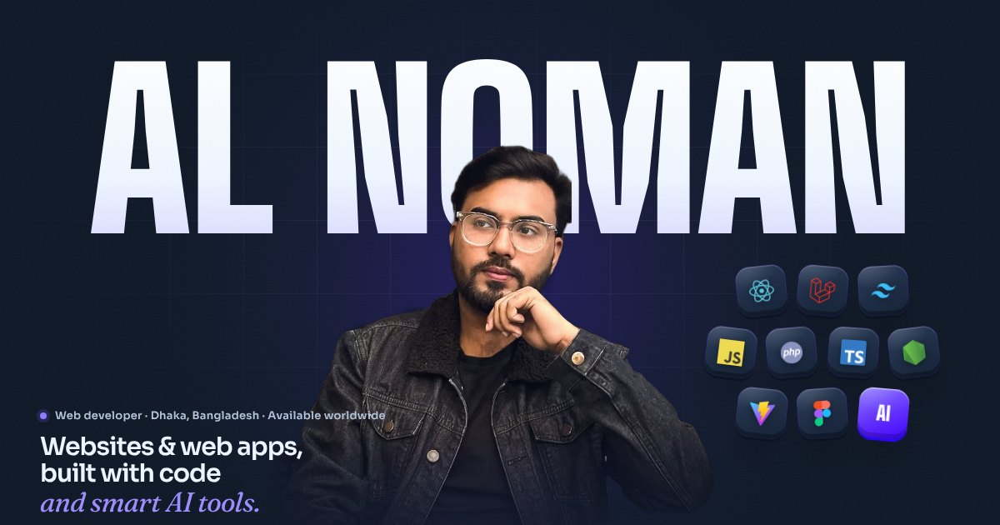

# Abdullah Al Noman | Web Developer Portfolio

[](https://alnoman.vercel.app/)
[](LICENSE)
[](https://vercel.com/)

The personal portfolio of Abdullah Al Noman, a web developer from Dhaka, Bangladesh. He builds fast, responsive websites and web apps with React, Tailwind CSS and Laravel, works with Shopify, and uses AI tools and prompt engineering to build and automate faster.

**Live site:** [https://alnoman.vercel.app/](https://alnoman.vercel.app/)



---

## Table of contents

- [Features](#features)
- [Tech stack](#tech-stack)
- [Projects showcased](#projects-showcased)
- [Project structure](#project-structure)
- [Getting started](#getting-started)
- [SEO and performance](#seo-and-performance)
- [Accessibility](#accessibility)
- [Deployment](#deployment)
- [License](#license)
- [Contact](#contact)

---

## Features

- Single-page layout: Hero, About, Services, Projects, Resume, Toolkit, Gallery, FAQ and Contact
- Pinned hero with a giant name, portrait and tool tiles that react to scroll (GSAP ScrollTrigger)
- Character-by-character title reveals and smooth scrolling (Lenis)
- "Everything your website needs" panel with draggable, physics-driven pills (Matter.js)
- Horizontal, pinned project showcase; hovering a card scrolls its full-page screenshot
- Filterable project index with a floating preview that follows the cursor
- 3D poster wall gallery with autoscroll, pause on hover and drag
- Buttons and nav with a travelling-light border and flowing gradient
- Footer name with a gradient that flows left to right
- Sections switch between dark and light themes as you scroll
- Fully responsive, and respects the `prefers-reduced-motion` setting

## Tech stack

| Area | Tools |
| --- | --- |
| Markup | HTML5 (semantic) |
| Styling | Tailwind CSS v4 (reset and build), custom CSS partials |
| Scripting | JavaScript (no framework) |
| Animation | GSAP + ScrollTrigger, Lenis smooth scroll |
| Physics | Matter.js |
| Fonts | Big Shoulders Display, Sora, Fraunces, Caveat (self-hosted) |
| Images | WebP, JPG, SVG |
| Hosting | Vercel |

## Projects showcased

| Project | Stack | Links |
| --- | --- | --- |
| Tormuz, startup agency website | HTML, Tailwind CSS v4, Vite | [Live site](https://alnoman30.github.io/Tormuz/) |
| Panto, furniture store website | React.js | [Live demo](https://alnoman-panto-design.vercel.app/) |
| Ultras, e-commerce website | Laravel, PHP | [Source code](https://github.com/alnoman30/Ultras-Ecommerce-Fullstack-Laravel) |
| Canvix, agency website | React.js | [Live demo](https://alnoman-canvix-agency.vercel.app/) |
| Syrah, wine shop front end | Front end, GitHub Pages | [Live site](https://alnoman30.github.io/Syrah_frontend_design/) |
| Clickverse, blog website | Laravel, PHP | [Source code](https://github.com/alnoman30/clickverse-fullstack-laravel) |
| Task Assistant, task manager app | React.js | [Live demo](https://alnoman-task-assistant.vercel.app/) |

More repositories are on [GitHub](https://github.com/alnoman30?tab=repositories).

## Project structure

```text
.
├── index.html            # The whole site (single page)
├── sitemap.xml           # Sitemap for search engines (with image entries)
├── robots.txt            # Crawler rules and sitemap location
├── package.json          # Tailwind build script
├── LICENSE
└── assets/
    ├── css/
    │   ├── tailwind.css  # Entry file: imports the partials below
    │   ├── src/          # base, header-hero, sections, footer
    │   └── style.css     # Built output (npm run build)
    ├── js/
    │   ├── main.js       # Interactions and animations
    │   ├── toss.js       # Physics pills
    │   └── vendor/       # GSAP, ScrollTrigger, Lenis, Matter.js
    ├── fonts/            # Self-hosted variable fonts
    ├── sounds/           # Background music
    └── images/
        ├── favicon/      # Favicons (violet N mark)
        ├── projects/     # Full-page screenshots (+ covers/ thumbnails)
        ├── gallery/      # Photos for the poster wall
        ├── skills/       # Technology icons
        └── og-image.jpg  # Social share preview
```

## Getting started

This is a static site, so there is nothing to install to view it.

**1. Clone the repository**

```bash
git clone https://github.com/alnoman30/alnomanfolio.git
cd alnomanfolio
```

**2. Rebuild the CSS after editing styles**

```bash
npm install
npm run build   # compiles assets/css/tailwind.css (+ src/) into assets/css/style.css
```

**3. Run it locally**

Serve the folder with any static server:

```bash
# Option A: Node
npx serve .

# Option B: Python
python -m http.server 8000
```

Then visit the address shown in the terminal (for example `http://localhost:3000` or `http://localhost:8000`).

You can also use the VS Code **Live Server** extension.

## SEO and performance

- Unique `<title>`, meta description and canonical URL
- Open Graph and X (Twitter) card tags with a 1200×630 preview image, for rich link previews
- JSON-LD structured data (`WebSite`, `Person`, `ItemList`, `SoftwareApplication` and `SoftwareSourceCode`) describing the site, the author and the projects
- `sitemap.xml` (with image entries) and `robots.txt` included
- Descriptive `alt` text on all meaningful images
- `width` and `height` on images to avoid layout shift
- Lazy-loaded images with `loading="lazy"` and `decoding="async"`
- Optimised WebP images, with small cover thumbnails for project cards
- Self-hosted, preloaded fonts

## Accessibility

- Semantic HTML with a logical heading order
- Skip link, visible focus styles and keyboard-friendly navigation
- Screen-reader-only text that announces links opening in a new tab
- Decorative elements hidden from assistive technology with `aria-hidden`
- Motion reduced for users who prefer it

## Deployment

The site is deployed on [Vercel](https://vercel.com/). Every push to `main` triggers a new deployment.

To deploy your own copy:

1. Fork or clone this repository
2. Import it into Vercel
3. Keep the default settings (Vercel runs `npm run build`, which regenerates `assets/css/style.css`)
4. Update the URLs in `index.html`, `sitemap.xml` and `robots.txt` to your own domain

## License

The source code is licensed under the [MIT License](LICENSE).

The personal photos, project screenshots and written content are © 2026 Abdullah Al Noman, all rights reserved, and are not covered by the MIT License. Please don't reuse them without permission.

## Contact

**Abdullah Al Noman**, web developer in Dhaka, Bangladesh, available worldwide.

- Email: [alnomaan30@gmail.com](mailto:alnomaan30@gmail.com)
- Portfolio: [alnoman.vercel.app](https://alnoman.vercel.app/)
- LinkedIn: [abdullah-al-noman30](https://www.linkedin.com/in/abdullah-al-noman30/)
- GitHub: [alnoman30](https://github.com/alnoman30)
- Facebook: [alnoman30](https://www.facebook.com/alnoman30/)
- Instagram: [noman.hehe](https://www.instagram.com/noman.hehe/)
